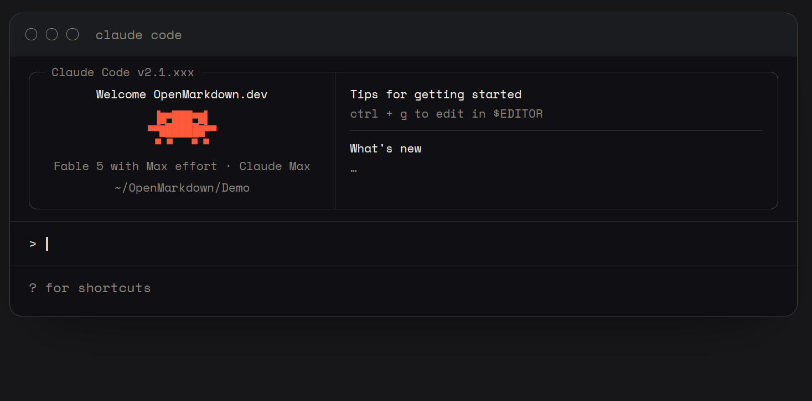
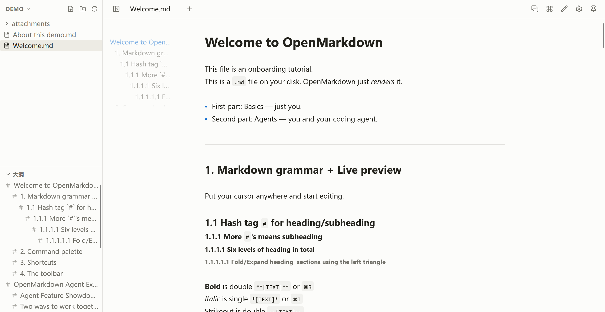
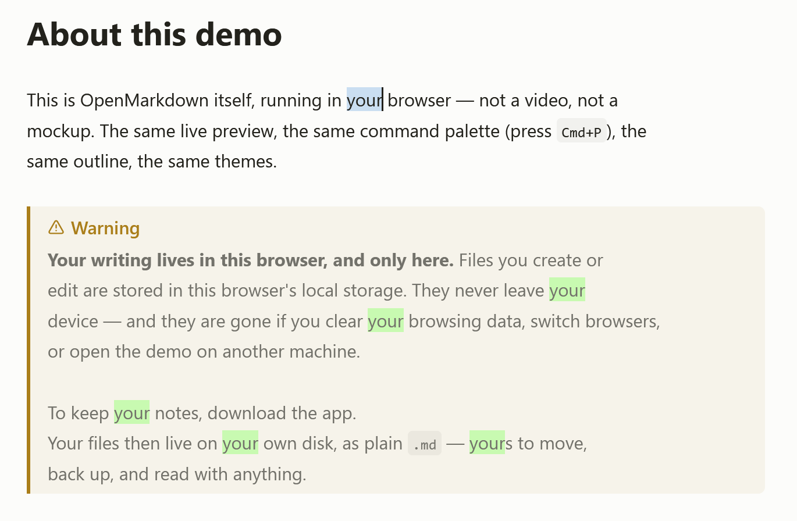

# Open 但不开源，Agent Native 但不内置 AI

- 信息来源：[OpenMarkdown](https://openmarkdown.dev/)

- - -

> 这里先吐槽一下，虽然这个软件名字叫 ##Open##Markdown，但它的 GitHub 仓库实际只放了构建好的版本，并没有实际开源。它的所谓“Open”更多地是指软件设计上的 Open。

这个产品与很多对标 Obsidian 以及 Typora 的产品类似，不过它并没有像其它产品那样简单粗暴地加上 AI 润色、AI 续写 或者 AI 对话侧边栏（不过它在后续版本中还是加入了基于 ACP 的 Agent 侧边栏功能）这样看起来很 AI 的功能，相反，它自己完全不直接请求 AI 服务。

## 那它有哪些功能呢？

简单介绍一下它最惊艳到我的两个功能

第一个功能，是它可以作为其它 Agent 产品（如 Claude Code）的提示词输入框。

第二个，是它把 Markdown 编辑器做成了类代码编辑器的体验。

比如它的界面设计布局非常像 VSCode

它支持代码编辑器中常见的选中文本后高亮相关部分的功能

它甚至实现了类似于 VSCode 配合 Claude Code 使用中将代码编辑器内的选中文本和打开的文件作为 Agent 上下文这样的体验

## OpenMarkdown 的商业化

目前看来 OpenMarkdown 这个产品已经具备一定的可用程度，不过他们团队对于商业化目前看来还是比较保守的，他们目前只在官网提供了单独的 [Support](https://openmarkdown.dev/support) 界面，用户可以付费支持他们的开发，不过付费用户暂时不会获得什么特别的功能服务。

## 小结

OpenMarkdown 这个产品我觉得很有意思，不是因为它解决了什么很真实的痛点，而是它向我展示了一种另类的做 AI Native 产品以及 Markdown 编辑器产品的思路。
